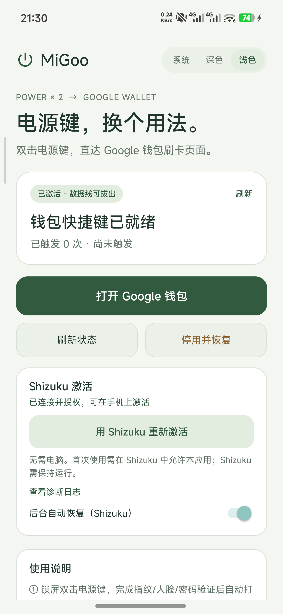
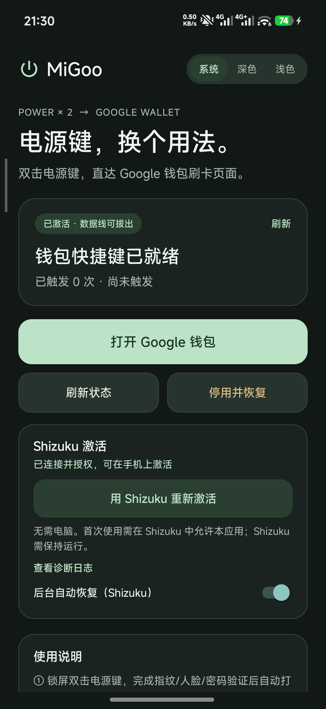
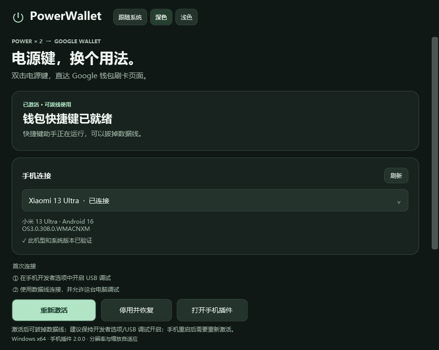

# PowerWallet · 电源键钱包

双击手机电源键，直接打开 **Google 钱包刷卡页面**。Windows 图形工具内置 ADB 和手机插件，可安装、激活、检查状态或恢复原快捷键，无需 root。

## 你会用到的Shizuku！https://github.com/RikkaApps/Shizuku

本仓库基于 [DustinYe/PowerWallet](https://github.com/DustinYe/PowerWallet) 的 MIT 源码修改。原项目只验证了小米 13 Ultra（ishtar）；本 fork 在 **REDMI Turbo 4 Pro（onyx）** 上完成了兼容性、锁屏流程、响应速度、手机端界面和 **Shizuku 免电脑激活** 的适配与真机验证。**红米 Turbo 4 Pro 已验证**，并保留小米 13 Ultra 的原验证路径。理论上支持澎湃系统全系，但是未测试。

- 版本：桌面端 **2.0.0**，手机插件 **2.0.0**（versionCode 6）
- applicationId：`cn.peng.powerwallet`
- 基石项目的包名 `cn.haiyu.powerwallet` 的安装会在桌面端激活时自动迁移

## 已验证设备

| 项目 | 值 |
| --- | --- |
| 机型 | REDMI Turbo 4 Pro（`25053RT47C`） |
| 设备代号 | `onyx` |
| 系统 | HyperOS `OS3.0.306.0.WOLCNXM` |
| Android | 16 / SDK 36 |
| 电源键设备 | `/dev/input/event2`（`pmic_pwrkey`） |
| Google 钱包 | `com.google.android.apps.walletnfcrel` |

## 界面

手机端采用与桌面版一致的卡片式设计，右上角可切换 **系统 / 深色 / 浅色**。切换时原地更新颜色，不重建 Activity，因此文字不闪、界面不白屏。

| 浅色 | 深色 |
| --- | --- |
|  |  |

桌面端界面（原项目设计）：



## 功能与 fork 改动

- **双击电源键打开 Google 钱包**：Windows 工具或手机端 Shizuku 安装并启动 ADB shell 助手，双击实体电源键后打开 Wallet 的 `QUICKDRAW` 页面。
- **Shizuku 免电脑激活（2.0.0 新增）**：手机端界面内置“Shizuku 激活”卡片。首次在 Shizuku 中授权后，可直接在手机上安装/重新激活助手；助手被系统清理后也能一键恢复，无需电脑。
- **Shizuku 恢复原快捷键（2.0.0 新增）**：助手已停止时，手机端点“停用并恢复”会通过 Shizuku 的 shell 身份读取备份并恢复 `mi_pay`。这是普通应用权限做不到的。
- **锁屏无闪现**：安全锁屏下双击只震动并留在锁屏，不提前启动 Wallet；指纹/人脸/密码验证完成后启动 Wallet。
- **更快显示**：双击判定窗口 120ms → **80ms**；解锁状态轮询 200ms → **50ms**；验证成功后 Wallet 启动与锁屏退场重叠；Wallet 使用 `--activity-no-animation`。真机确认速度可接受。
- **轻触震动**：双击固定使用 `VibrationEffect.EFFECT_TICK`（系统轻触），在真机逐个试听后选定。
- **手机端 UI**：卡片式布局、矢量电源图标、状态卡片、Shizuku 激活卡片、主操作按钮、使用说明；支持系统/深色/浅色主题，原地换色、不闪文字。
- **通用 HyperOS 兼容**：桌面端和手机端不再要求 `ishtar + OS3.0.308.0.WMACNXM`；接受 `ro.build.version.incremental` 以 `OS` 开头的 HyperOS（桌面端同时参考 `ro.mi.os.version.name`），保留小米 13 Ultra 原验证路径。
- **电源键设备选择**：按设备名打分，优先 `pmic_pwrkey`，排除 `bark`、触摸屏、`goodix` 等重复 KEY_POWER 设备。
- **旧签名/旧包名迁移**：桌面端遇到 `INSTALL_FAILED_UPDATE_INCOMPATIBLE` 会自动停止旧助手、卸载旧签名插件再安装；检测到旧包 `cn.haiyu.powerwallet` 时，会先恢复旧助手保存的快捷键、停止旧助手、卸载旧包，再安装 `cn.peng.powerwallet`。
- **setsid 启动**：桌面端和 Shizuku 启动器都用 `setsid` 让助手脱离会话；在应用和 Shizuku 服务保持运行时，关闭开发者选项后本机仍可工作（有条件，不保证系统清理后仍存活）。
- **只读诊断**：手机端助手支持 `--probe`，不修改设置即可检查设备、输入设备和隐藏 API。

## 使用

### 方式一：电脑激活

1. 手机开启「开发者选项 → USB 调试」，用数据线连接电脑并允许调试授权。
2. 运行 Release 中的 `PowerWallet-Setup-2.0.0-onyx.exe`，点击 **「安装并激活」**；如手机弹出 USB 安装确认，请在手机上允许。
3. 显示「钱包快捷键已就绪」后可拔线。
4. 锁屏下双击电源键：轻触震动并留在锁屏，完成验证后自动打开 Wallet；解锁状态下双击直接打开 Wallet。

### 方式二：Shizuku 手机端激活（无需电脑）

1. 手机安装并启动 Shizuku（本机验证版本 13.6.0），确保 Shizuku 服务运行。
2. 打开「电源键钱包」，在 **Shizuku 激活** 卡片点击「用 Shizuku 激活」。
3. 首次使用在 Shizuku 弹窗中选择「始终允许」。
4. 授权后会自动安装助手并启动，状态卡片显示「已激活 · 数据线可拔出」。
5. 手机重启或助手失效后，再次点「用 Shizuku 重新激活」即可；不需要连接电脑。

> 首次授权按 applicationId 记录；覆盖安装同签名版本会保留授权。卸载重装后需要重新授权。

## 恢复

- 电脑端：连接手机后点击 **「停用并恢复」**。
- 手机端：打开「电源键钱包」，点击 **「停用并恢复」**。
  - 助手仍在运行：通过 Binder 停用并恢复。
  - 助手已被系统清理：自动改用 Shizuku 的 shell 身份读取 `/data/local/tmp/powerwallet-state.properties` 中的原始值并恢复 `mi_pay`。
- 如果 Shizuku 未运行且助手已停止，手机端无法自动恢复；可启动 Shizuku 后重试，或连接电脑恢复。

恢复后可卸载手机插件。本工具不读取银行卡、NFC 交易数据或 Google 账户，也不执行付款。

## 从 1.x 升级

1.x 使用包名 `cn.haiyu.powerwallet`，2.0.0 改为 `cn.peng.powerwallet`，两者可以短暂共存，但助手 socket 相同，不能同时运行。

- **推荐**：直接运行桌面端 2.0.0 并点击「安装并激活」。工具会检测旧包，先恢复原快捷键、停止旧助手、卸载旧包，再安装并激活新包。
- **手动**：先在旧版手机端点「停用并恢复」，再卸载旧版「电源键钱包」；然后安装 2.0.0。之后在 Shizuku 中重新授权新包。
- 旧包卸载后，`/data/local/tmp/powerwallet-state.properties` 和原始值备份会保留，新助手会继续使用。

## 构建

### Windows 桌面端

需要 .NET Framework 4.8（Windows 10/11 通常已内置）：

```powershell
powershell -NoProfile -ExecutionPolicy Bypass -File .\desktop\build.ps1
```

输出 `dist\PowerWallet-Setup-2.0.0.exe`。桌面端会把 `desktop/assets/PowerWallet-2.0.0.apk` 嵌入 EXE；替换 APK 后请同步更新 `desktop/assets/SHA256SUMS.txt`。

### Android 手机端

需要 JDK 21、Android SDK Platform 36/37、Build Tools 36.0.0：

```powershell
.\android\Build.ps1 -Sdk 'Android SDK 路径' -Jdk 'JDK 21 路径' -BuildDirectory '构建目录' -ApkPath '.\desktop\assets\PowerWallet-2.0.0.apk'
```

`android/libs/` 已包含 Shizuku API 13.1.5 的 jar 和 androidx annotation；构建脚本会把它们加入 `javac` classpath 和 `d8` 输入。

仓库不包含 APK 签名私钥。`android/Build.ps1` 会在构建目录生成个人 keystore；自行构建的 APK 与仓库内置 APK 签名不同，不能直接覆盖安装。切换签名前请先恢复原快捷键并卸载旧插件。

**不要提交 `*.jks` / `*.keystore`。** `.gitignore` 已忽略这些文件以及 `dist/`、`artifacts/`、日志和 IDE 产物。

> `android/Build.ps1` 中的默认 keystore 口令只用于本地演示构建。如果你长期使用自己的签名，请修改 keystore 密码，并只在本地保存私钥文件。

## 验证

- 桌面端离线自检：**449 项通过**，覆盖兼容性、onyx 已验证路径、旧签名自动卸载、旧包名迁移、恢复流程、38 组主题/分辨率/缩放布局。
- 真机：只读探针、安装激活、`double_click_power_key=google_pay`、原值 `mi_pay` 备份、锁屏双击验证、解锁后 Wallet 启动、速度测试、浅色/深色切换均通过。
- Shizuku 2.0.0 真机验证：授权弹窗、手机端激活、杀掉助手后重新激活、助手死亡后通过 Shizuku 恢复 `mi_pay`、覆盖升级保留授权、新包名双击均通过。
- 关闭开发者选项 + Shizuku 测试：`shizuku_server` 保持运行，助手/应用进程存活，锁屏双击可打开 Wallet；助手以 `setsid` 启动。
- 详细记录见 [`docs/onyx-verification.md`](docs/onyx-verification.md)，最新自检输出见 [`docs/onyx-self-test-results.txt`](docs/onyx-self-test-results.txt)。

## 限制

- **Shizuku 必须保持运行并授权**，手机端免电脑激活/恢复才可用。没有Shizuku且助手已停止时，仍需连接电脑恢复。经测试，只要不手动停止Shizuku，就可以一直存在。
- **手机重启后助手停止**：可用 Shizuku 或电脑重新激活；这是无 root 设计，助手没有开机自启。
- **开发者选项/USB 调试**：建议保持开启。除非您的设备是红米T4P，经过测试可以关闭开发者选项。
- **普通应用不能写快捷键设置**：HyperOS SettingsProvider 拒绝普通应用写 `double_click_power_key`，即使授予 `WRITE_SETTINGS` / `WRITE_SECURE_SETTINGS`。因此助手死亡后的自动恢复依赖 Shizuku 的 shell 身份，而不是应用自身权限。
- HyperOS 大版本更新可能改变双击电源键实现；失效时先「停用并恢复」，再重新激活。
- 需要手机已安装并完成 Google 钱包设置；支付仍由 Google 钱包和系统验证处理。
- 真机已通过真实 NFC 读卡器付款。

## 原项目文档

`docs/usage.md` 和 `docs/verification.md` 是原项目（小米 13 Ultra）的文档；本 fork 的 onyx 适配与验证见本 README 和 `docs/onyx-verification.md`。

## 许可

本项目自有源码采用 [MIT](LICENSE)。内置 ADB 和 USB 组件遵循其原始许可，完整声明见 [THIRD_PARTY_NOTICES.md](THIRD_PARTY_NOTICES.md) 和 `desktop/assets/NOTICE.txt`。本项目独立开发，与 Xiaomi、Google 无隶属或背书关系。
